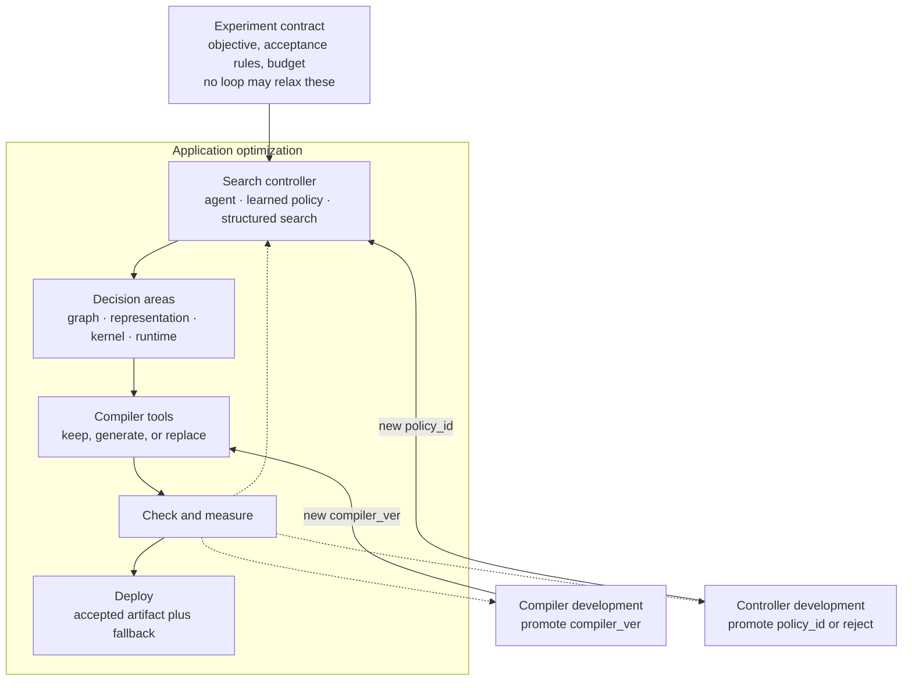

# Lintel

**Goal:** a next-generation **agentic compiler**. It chooses actions, synthesizes implementations, and evaluates them under a fixed contract. It can change its compiler tools or its decision procedure only in separate measured loops. Deploy loads an accepted artifact and a fallback, with no optimizer-model on the hot path.

Lintel is the **control plane**: what to try, what to ship, what to roll back, and what may change across jobs. The early-stage picture and its function coverage are [docs/ARCHITECTURE.md](docs/ARCHITECTURE.md). Choreo is one representation the proposer may edit. Mapping to hardware is a replaceable component. This repository is the written contract (`schemas/` / `examples/`) plus that design. It does not run CI and it does not emit binaries. Evidence: [ai-compiler-survey](https://github.com/zackc6/ai-compiler-survey) (read in place; this repo does not copy it).

**Year-1 SKU.** CI/hot-path specialize on Amdahl-ranked kernels → layered admit → freeze a content-addressed artifact → serving A/B on one engine → classical fallback. Customer owns the artifact.

**What we refuse to sell in year 1.** “LLM replaces the compiler.” “Default-on for every build.” “One agent IR for all vendors.” “The control plane improves itself” as a year-1 result. The controller loop is in the architecture; this slice does not run it. A session log sold as a new controller. Mid-walk checker rewrite. Search with no check, mapping to hardware, or fallback.

**Maintainer git.** Work is an IR increment on a gap from [`gaps/`](gaps/) (gap → schema change → carrier → falsifier), on a `claude/*` or `chatgpt/*` branch, argued in [`STATUS.md`](STATUS.md) (two rounds per side), and landed through a pull request the maintainer approves — see [`AGENTS.md`](AGENTS.md). Thread entries, gap files and fact fixes go to `main` directly. GitHub Actions: the contract validator and the two debate workflows; no build CI. Validation gate: `python3 scripts/validate_contract.py`.

## Start Monday

Week-1 decisions are in [docs/YEAR1.md](docs/YEAR1.md). Why this IR and the Acme walks: [docs/WHY.md](docs/WHY.md). The year-1 executable is [docs/POC.md](docs/POC.md) (control CFG+cost+ADG **and** Choreo Kernel AST). Not the linear v0 examples; not Cake IR; not Triton knobs.

| Path | What it is |
|---|---|
| [docs/WHY.md](docs/WHY.md) | Why the IR, what we benefit, Acme walks (L1–L7) |
| [docs/PRODUCT.md](docs/PRODUCT.md) | What we sell, and why Cake+DSH alone is the wrong SKU |
| [docs/ARCHITECTURE.md](docs/ARCHITECTURE.md) | Early-stage picture, function coverage, three loops |
| [docs/DATA_PLANE.md](docs/DATA_PLANE.md) | Choreo Kernel AST as year-1 L4; Triton is the printer |
| [docs/CHOREO.md](docs/CHOREO.md) | Verdict + vs Cake / Argus / TIRx / LLM-oriented IR; remaining Lintel work |
| [docs/LLM_IR.md](docs/LLM_IR.md) | New Compiler Stack taxonomy → Selector/stratum pins |
| [docs/LLM_ORIENTED_IR.md](docs/LLM_ORIENTED_IR.md) | Independent LLM-oriented IR survey (primary papers; not the other survey) |
| [docs/ADAPTERS.md](docs/ADAPTERS.md) | `adapter_id` table (live / stub / later) |
| [docs/YEAR1.md](docs/YEAR1.md) | Quarters, 10/25/50 staffing, week-by-week Q1, hiring order, GTM |
| [docs/MARKET.md](docs/MARKET.md) | Business value, unit economics, competitors over 1–3 years |
| [docs/RISKS.md](docs/RISKS.md) | Kill switches tied to survey checkpoints |
| [docs/SURVEY_MATCH.md](docs/SURVEY_MATCH.md) | Scope and the three loops, against the 23 Sep 2026 survey |
| [docs/SURVEY_MAP.md](docs/SURVEY_MAP.md) | Jobs, C1–C10, T1–T10, P1–P23 → year-1 choice |
| [docs/ADMIT_RECORD.md](docs/ADMIT_RECORD.md) | Annotated admit record (landed + reverted) |
| [docs/LINTEL_IR.md](docs/LINTEL_IR.md) | Lintel IR: land / revert / reject + cache_key |
| [docs/POC.md](docs/POC.md) | Year-1 hard kernel: CFG + cost + ADG + Choreo L4 |
| [docs/LATER.md](docs/LATER.md) | Coverage after PoC (`%w`, policy-hash, more edges, `@cake.v0` wrap) |
| `schemas/` | v0 linear + poc CFG/cost + adapter-proposal; admit record, session, cache key |
| `scripts/validate_contract.py` | Validation gate: schemas are valid JSON Schema 2020-12, examples parse |
| [STATUS.md](STATUS.md) | Open batch table and Review thread (the debate lives here) |
