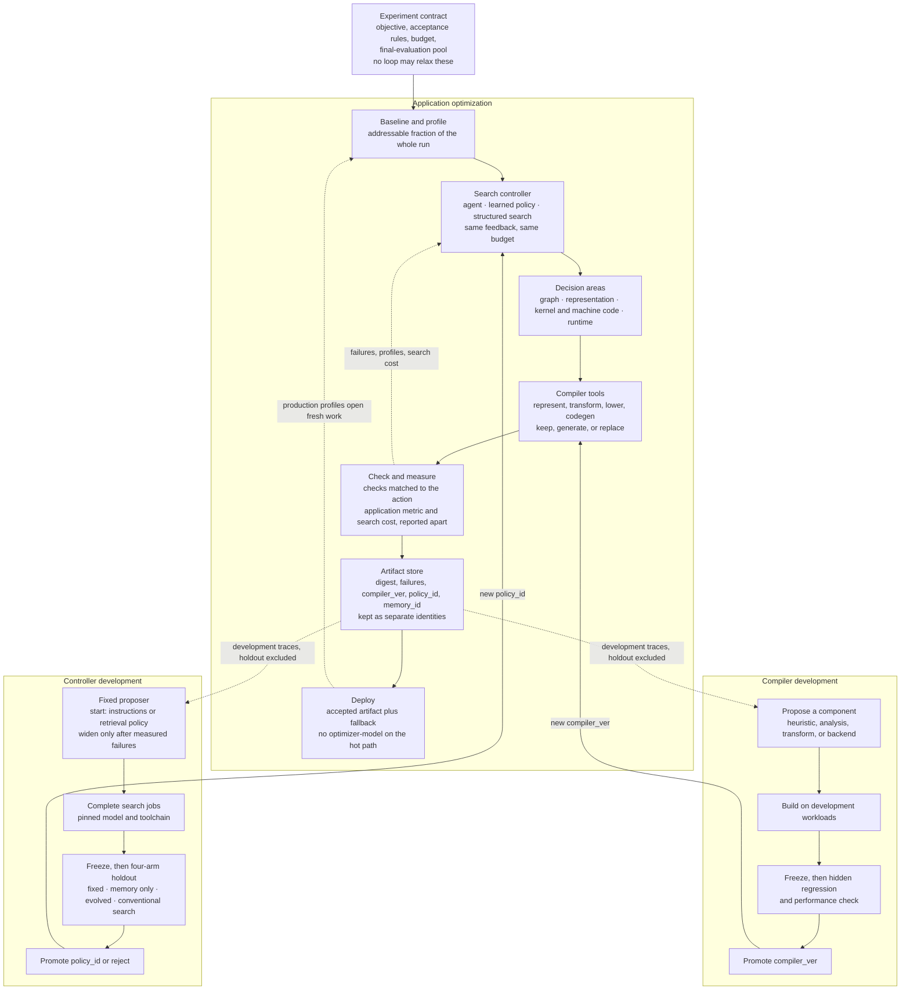

# Architecture

**Goal:** a next-generation **agentic compiler**. It chooses optimization actions, synthesizes implementations, evaluates them under a fixed contract, and changes its compiler tools or its own decision procedure only through separate, measured loops. Deployment loads an accepted artifact and a fallback. Lintel is the **control plane**.

This page is the early-stage design: function coverage and the three loops, judged against the [23 September 2026 survey](https://github.com/zackc6/ai-compiler-survey) (`docs/SURVEY.md`, especially §2.4, §3.1, §3.3, §5.1). It does not copy that tree. A narrow product slice (one kernel surface, humans own the procedure) lives in [YEAR1.md](YEAR1.md) and [SURVEY_MATCH.md](SURVEY_MATCH.md). That slice does not define this picture.

The objective is a field of the **contract**, chosen per experiment: serving throughput under a latency and quality bound, training step time, or coverage until a new target can run. The architecture does not hard-wire one workload or one decision area.

Cake, DeepSeek Harness, and GEAK are **mechanisms**. Why the control IR exists: [WHY.md](WHY.md). One representation: [DATA_PLANE.md](DATA_PLANE.md), [CHOREO.md](CHOREO.md). LLM role: [LLM_IR.md](LLM_IR.md).

## Early-stage picture

Humans fix the experiment contract. Application search proposes with three methods under the same feedback and budget. Compiler tools are replaceable components. Two offline loops promote a new compiler or a new procedure only after a withheld final check. Deploy does not call the optimizer model.



| Piece | What it owns |
|---|---|
| **Contract** | Objective, numerical and quality rules, required checks, budget, and the final-evaluation pool. A human changes it by opening a new experiment. |
| **Search controller** | Which decision area to open, which candidates to try, when to stop. An agent, a learned policy, and structured search are peers. |
| **Compiler tools** | Representations, transformations, and mapping to hardware. Execution coordination is the runtime decision area, and it is the same kind of replaceable component. After a promotion a tool is an ordinary function: candidate in, findings or a binary out. |
| **Check and measure** | Acceptance. Structural checks, reference tests, numerical and quality checks, scoped equivalence, and application measurement. Search cost is a second result, not a substitute for speed. |
| **Artifact store** | Accepted artifacts, failed candidates, and separate records for the digest, `compiler_ver`, `policy_id`, and `memory_id`. The contract is not a search result. |
| **Deploy** | `lookup` of the accepted artifact, plus last-good or classical. The application may contain models. The optimizer does not. |
| **Compiler development** | A reusable analysis, heuristic, transformation, or backend. It must help workloads besides the one that motivated it. |
| **Controller development** | A reusable decision procedure. `promote` publishes `policy_id`. It does not store a binary. Recursive edit of the proposer is a further experiment. |

**What the picture claims.** One control plane, three evaluation boundaries. A localized failure is feedback into the search controller, not a silent rewrite of the contract, the compiler, or the procedure. A promoted compiler returns as a tool. A promoted procedure returns as the search controller. Memory is a snapshot the same procedure can read. It is not a fourth loop.

**Clocks.** Inside one application job the compiler pin, the procedure pin, the model pin, and the contract are fixed. Across jobs, a new `compiler_ver` or a new `policy_id` is a new identity and must be re-admitted. Rewriting a checker or the running search graph in the middle of a job stays forbidden.

Choreo is one representation the searcher may edit (tiles, roles, barriers, layouts). It is not the only legal representation. A sink that consumes the schedule is one mapping to hardware. Generating or replacing that mapping is a compiler-development experiment, measured against the path it would replace.

## Function coverage

Five functions every compilation system keeps. The implementation of each is replaceable. Passes are a review unit, not a required user-facing layer.

| Function | What it must achieve | Early-stage coverage |
|---|---|---|
| **Represent** | Keep enough information to implement and evaluate the workload. | A workload spec plus one or more representations behind the adapter seam. Choreo Kernel is one. A portable experiment record (workload, actions, results, artifact identity) spans backends that do not share an executable IR. |
| **Transform and optimize** | Find an acceptable implementation with better performance under the contract. | Three proposers, one budget, one feedback channel. Candidates may be configurations, synthesized kernels, fusions, or rewrites. Local search is the start. Coordinated search is the comparison when fusion, tiling, communication, and placement interact, and it includes a non-agent joint-search arm. |
| **Map to hardware** | Produce runnable code with the required behavior. | Start by reusing a backend that implements the chosen representation. If that backend drops schedule information or cannot express the target, compiler development evaluates another lowering path or a generated backend against it. |
| **Validate** | Establish confidence under an explicit contract. | The check is chosen from the action, not from a single oracle. Configuration, reduction order, and a generated backend need different evidence. The contract itself is not a check the optimizer may edit. |
| **Coordinate execution** | Respect dependencies and resource constraints. | Runtime and distribution are a decision area: dispatch, batching, placement, communication, persistent kernels versus a general runtime. Serving measurement is the application oracle when the contract is a serving objective. |

### What the control plane can do

These are functions of one control plane, not a requirement for one agent per row.

| Function | Persists as | Bound |
|---|---|---|
| Propose configurations | Application candidate | Same slots and budget as structured search and a learned policy. |
| Synthesize kernels, fusions, algorithms, or low-level code | Application candidate | Declared semantics and the numerical contract. Wider synthesis is compared with the restricted action space before a new representation is adopted. |
| Diagnose a failed or slow candidate | Feedback `{where, seam, reason}` plus a profile | The diagnosis has to predict a later measured improvement. |
| Choose scope | Which decision area the job opens | Application benefit after the changes are integrated, not a local microbench alone. |
| Evolve a compiler component | `compiler_ver` | Hidden regression set. Merged code has no optimizer-model on the normal path. |
| Reuse experience | `memory_id` | Compatibility with the current hardware, compiler, and input assumptions. A longer log under the same retrieval rule is not a new procedure. |
| Improve the controller | `policy_id` | Four arms, pinned model and toolchain, holdout families absent from development traces. Start with instructions or the retrieval policy. Search strategy, orchestration, and agent code wait until those leave a measured failure. The improvement procedure itself is a later experiment. |

### Decision areas

A checklist of choices to expose. Not a layer count, and not a single central searcher required by a global objective.

| Decision area | Choices the controller can open | Combine it with another area when |
|---|---|---|
| Workload and graph | Shapes, partitioning, fusion, specialization | Graph boundaries block a useful kernel or memory plan. |
| Representation and transformation | Layout, memory planning, algebraic rewrites, pass selection | A local choice constrains a later schedule. |
| Kernel and machine code | Tiling, pipelining, synchronization, instructions, registers | Backend behavior decides whether a schedule is fast. |
| Runtime and distribution | Dispatch, batching, dependencies, placement, communication | The critical path crosses a kernel or a device boundary. |
| Evaluation and deployment | Which checks, which measurement, which artifact, rollout and rollback | Optimization assumptions and deployment assumptions differ. |

Hardware co-design is a further experiment on the same control plane: a hardware design parameter (a proposed device, not merely a choice among existing devices) searched together with an execution strategy, against separately optimized baselines, on measured hardware or a simulator whose fidelity is stated. It is not a sixth IR.

### Identities

Classify an edit by what persists.

| Identity | What it versions | Who may change it |
|---|---|---|
| **Contract** | Objective, tolerances, required checks, budget, final-evaluation pool | Humans, by opening a new experiment. Every automatic loop is forbidden to relax it. |
| **Application digest** | The accepted executable for this workload on this hardware, compiler, representation, procedure, and contract | The application loop, by `land` / `revert` / `reject`. |
| **`compiler_ver`** | Analyses, transformations, representations, backends | The compiler loop, after a hidden regression check. |
| **`policy_id`** | Instructions, search strategy, retrieval policy, which areas and slots exist, stopping rules | The controller loop, by `promote`, or a human edit. It does not version the contract. |
| **`memory_id`** | Traces and examples the same procedure reads | Append-only. Outside the cache key. Once a key has landed, a new snapshot does not replace that digest. |

```text
cache_key = hash( workload_id, hw_id, compiler_ver, adapter_id, policy_id, contract_id )
```

`workload_id` is the decision surface of the job. A captured graph hash is that id when the surface is one subgraph. A job that changes fusion or placement has a workload id that covers the surface it actually searched. `model_id` stays audit. The proposal body is the value stored at the key, not a field of the key.

v0 examples still hash `graph_hash` and pin the contract in the module text, with historical notes that folded the objective into `policy_id`. That encoding is the narrow slice. A controller delta is illegal if it uses that encoding to move \(F\) or the gate set. Laws: [LINTEL_IR.md](LINTEL_IR.md).

### What each role may change

| Role | May change | Bound |
|---|---|---|
| Application optimization | Scope across the decision areas; synthesized programs; diagnosis; reuse of compatible experiments | Validation and target measurement decide. The agent keeps the slot only where it beats the other proposers at the same budget. |
| Compiler development | Heuristics, analyses, transformations, backend support, coverage on a new target | Development feedback, then a separate regression and performance check. Measure a compiler change and a procedure change alone before measuring them together. |
| Controller development | First instructions or retrieval policy; broader procedure only after a measured miss | Late to *run*: after application search and compiler evolution have repeated value. Designed here so a log cannot be mistaken for it. No application-level evidence yet; re-read at the survey checkpoint, 23 September 2027. |
| Fixed for the experiment | Workload, objective, contract, final-evaluation pool, submission limit | Changing these is a new experiment. Final tasks and results stay out of every proposer. |

Deploy runs accepted artifacts and keeps a fallback. Production profiles identify the next job. They do not retune a landed key.

## E2E software stack

Two paths. Same cache key. The specialize path may use a model. Deploy must not. The drawing below is one instantiation, with serving throughput as the contract. The same control plane uses step time, or coverage until the application runs, when that is the contract.

```text
 MODEL / FRAMEWORK          torch.compile · exported graph
        │
        │  regions · fingerprints · Amdahl rank
        ▼
 fitness F = serving tokens/s (or TTFT) · quality parity · $/compile
        │
 ┌──────┴───────────────────────────────────────────────────────────┐
 │  LINTEL CONTROL PLANE                                            │
 │                                                                  │
 │   Lintel IR (CFG · cost · cache_key · land|revert|reject)       │
 │   %k = workload, hw, compiler, adapter, policy, contract             │
 │                                                                  │
 │   session log = interpretation trace     (DSH pattern)           │
 │   seams: llm · tools · sandbox · adapter · oracle · serving      │
 └──────┬───────────────────────────────┬───────────────────────────┘
        │ SPECIALIZE (CI / overnight)   │ SERVE (production)
        │ compile → ADG; walk ADG      │ lookup %k
        │ proposer fills candidates     │
        ▼                               ▼
 admit record (lowering)          hit: artifact.digest
 land under %k                    miss / replay-fail:
        │                           last_good | classical
        ▼                               │
 adapter IR  Choreo Kernel AST (yr1) │  NO LLM
   GPU sink (must consume schedule)  │
   later: @tirx.v0 / @tilelang.ascend│
        │                               │
        ▼                               ▼
 classical lowering / vendor libs ──► SGLang xor vLLM ──► GPU
```

**Invariant.** If the controller, the LLM, or a plugin dies, `lookup(%k)` still serves the last freeze (or classical). That is the commercial sentence.

**A narrow run** uses one hardware family, one representation, and one engine. That is a product slice ([YEAR1.md](YEAR1.md)), not a missing function. The architecture already has a second representation as a new `adapter_id`, a second engine as a serving provider, and a generated backend as a `compiler_ver`. A printer that comments `Pipeline.depth` is not mapping to hardware.

## Lintel IR and today’s stack

L1–L7 below are **names for a stack a partner already runs**. The decision-area checklist above is the architecture. These bands are one way that checklist shows up in today’s tools. The survey’s [§5.1.2](https://github.com/zackc6/ai-compiler-survey/blob/main/docs/SURVEY.md) does not define an “L8.” Lintel IR talks to the areas. One analytical cost model across the whole stack stays a non-goal. Which area a product slice searches first: [SURVEY_MATCH.md](SURVEY_MATCH.md).

```text
  L1  Framework graph     torch.compile / exported module
  L2  Portable graph IR   graph_hash in %k (StableHLO-class when present)
  L3  Mid-IR / dialects   Inductor / MLIR / HLO — classical, not proposed in PoC
  L4  Kernel DSL          adapter: Choreo Kernel AST (yr1) · GPU sink · Tile / HIP / `@tirx.v0` / `@tilelang.ascend` / Cake (later wraps)
  L5  Backend / ISA       PTX / SASS — classical lowering of L4
  L6  Runtime / serving   SGLang xor vLLM · CUDA Graphs · lookup(%k)
  L7* Fleet / cluster     out of PoC; later placement plugin, not a FleetIR SKU
  L0* CPU / LLVM          job (b) — out
        │
        │  control plane talks *to* bands through seams
        ▼
  Lintel IR  triage / propose / gate / cost / land   ← this product
  ADG walk   (specialize)          lookup(%k) (serve)
```

Worked example: [examples/poc/acme_attn_prefill.poc.lintel](../examples/poc/acme_attn_prefill.poc.lintel). Same `%k`. Each op touches one band (or none — control only). Step-by-step walks (land / revert / cost skip / cold / replay): [WHY.md](WHY.md).

| PoC op | Band | What happens | What Lintel IR does **not** do |
|---|---|---|---|
| `region` + `graph = sha256:bbcd57…` | **L1→L2** | Fingerprint of the captured attn-prefill subgraph | Rewrite the torch graph; invent a portable IR |
| `triage` · `cond %r.hot` | **L1** (cut) + Amdahl | Skip cold regions (`^cold` → `revert`) | Fuse ops at L3; change the export boundary |
| `pins.compiler` / `adapter = @choreo.v0` | **L3/L4 pin** | Which classical stack must replay (`choreoir` + sink) | Run InstCombine / Inductor passes |
| `%p0 = propose … kernel choreo.attn.d3.w4` | **L4** | Fill an allowlisted Choreo Kernel AST | Emit CUDA, free Triton source, or Cake IR |
| `gate adapter` `{where: L}` | **L4 pre-codegen** | `choreoir.check` localized Finding | A new checker IR inside Lintel |
| `gate golden` / `gate numerical` | **L4 after L5 lower** | Oracle on the cubin the adapter produced | Legalize PTX; allocate registers |
| `cost … budget.usd = 50` | **control** (survey: economics are not a band) | Skip L6 A/B if it cannot pay back | A universal L1–L7 analytical model |
| `gate serving_ab` · `fitness F = tokens/s × parity` | **L6** | Warm-server A/B + output parity | Own CUDA Graphs / KV cache / the engine |
| `land %p0 under %k` | **L6 freeze** | `store[%k] = digest`; serve is `lookup(%k)` | Re-run Lintel IR on the hot path |
| *(not in PoC)* `place` | **L7** | Later plugin ([LATER.md](LATER.md) coverage) | Ship FleetIR |

**C4** (Triton vs Tile vs Cake IR) is an **L4 sink** fight. Year 1 picks one L4 **face** (Choreo) and one printer. A second DSL is a new `adapter_id` or printer (new `%k`), not a new Lintel IR.

A recurring kernel fail becomes a **PR on `choreoir`**. After merge, `check` is still an ordinary function, `compiler_ver` bumps, and the next application job has a new `%k`. A tighter allowlist is a new `policy_id`, not that PR. An L5 `where` (`ptx.barrier`) may later grow as an **oracle plugin** here. It does not grow an ISA dialect in this company. Spec: [CHOREO.md](CHOREO.md) Undergo.

**L0 / job (b)** (Magellan / MLGO) never appears in Lintel IR.

### Three loops

The picture above is the architecture. This is the same split in the vocabulary of today’s stack. Judgment of what a product slice ships: [SURVEY_MATCH.md](SURVEY_MATCH.md).

```text
  APPLICATION                       COMPILER                       CONTROLLER
  contract, policy, compiler pinned recurring limitation           offline procedure delta
  agent, learned policy, or search  → component proposal           start: instructions or retrieval
  across the open decision areas    → hidden regression            pinned compiler, pinned model
  check → measure → land|revert     → new compiler_ver             dev jobs → freeze → holdout
  deploy = lookup                   merged tool is an ordinary fn  promote policy_id | reject
                                                                   does not store a binary
                                                                   deploy never runs this module
```

Inside one application walk the procedure, the compiler, and the contract are pinned. Fail `{where}` is feedback to the next candidate. Across jobs, `compiler_ver` and `policy_id` are different fields of the cache key. A session log is memory (`memory_id`, outside the key). Rewriting a checker or the running search graph mid-walk stays forbidden ([RISKS.md](RISKS.md)). Sketch: [examples/later/controller-dev.sketch.lintel](../examples/later/controller-dev.sketch.lintel).

Worked walks: [WHY.md](WHY.md). Source: [examples/poc/acme_attn_prefill.poc.lintel](../examples/poc/acme_attn_prefill.poc.lintel). Same `graph_hash` `sha256:bbcd57f9…`.

| Walk | Band(s) | What the controller does | What it does **not** reshape |
|---|---|---|---|
| **D cold** `cond %r.hot` → `^cold` revert | **L1** cut | Skip L4–L6 spend (Amdahl / P23) | No torch rewrite, no new L2 IR |
| **F `{where: L}`** Copy Q\[128,64\]→SmQ\[64,64\] | **L4** pre-codegen | CFG **edge** `^try0`→`^try1`; Finding names `c0` | No L1 graph edit; no PTX |
| **A land** adapter+golden+numerical+`serving_ab` +8.1% | **L4→L5→L6** | Only \(F\) admits; then `land` under `%k` | No InstCombine; no CUDA Graphs ownership |
| **B revert** +11% bench, parity 3/1000 | **L6** \(F\) | Microbench does not win; last_good still serves | L4 kernel is not “the optimum” |
| **C cost skip** `worth_measure=false` | **control** (not a band) | Skip L6 canary; economics are policy | No PowerIR / CostIR dialect |
| **E replay** model swap, same `%k` | **L6** freeze | Serve `lookup(%k)`; no LLM | L1–L2 unchanged |
| **Compiler, next night** (not in the PoC file) | **kernel compiler** | New `choreoir` pin; same `graph_hash`; new `%k` | The graph is not re-authored; the procedure (`policy_id`) is not what changed |
| **Controller promote** (not in the PoC file) | **control** | New `policy_id` after a held-out comparison; later jobs re-land | Does not run inside `^try0`; does not edit \(F\) |

The worked walks exercise one surface: a fingerprinted graph, a pinned mid-IR, a kernel schedule, and serving measurement. That is the PoC, not the decision-area checklist. Placement and CPU/LLVM are absent from that file. They remain areas the architecture can open. A product rule for when to open the next area is in [SURVEY_MATCH.md](SURVEY_MATCH.md).

## Mechanisms (what we take, where they sit)

| Mechanism | From | In this stack | We discard |
|---|---|---|---|
| Typed agent contract + **localized reject** | Cake / Choreo | `propose` **Kernel AST** + `gate adapter` `{where, hint}` + `gate` `{where, seam, reason}` | Cake IR as the kernel language; Choreo-the-company |
| Plugin **seams** + append-only session log | DeepSeek Harness | Runtime around Lintel IR; model-visible ⇒ logged | Coding-agent UX as the SKU; free tool-calling on the SLA path |
| Amdahl on a **warm** server + A/B + parity | GEAK v4 | `triage` + `gate serving_ab` + \(F\) | Instinct-only marketing; hero-kernel as “default agent compile” |
| Artifact-in-VCS / control file | CompileIQ-class | `land %p under %k` → customer git | Vendor-only ACF as the ABI |
| **Cache key + replay** | Artifact identity separate from the search trajectory | `%k = cache_key(...)`; same key ⇒ same terminator or hard fail. `memory_id` stays outside `%k` | Silent retune on model swap; treating a log as a new controller |
| Lintel IR | This product | Control-plane IR; JSON record is a **lowering** | Mega-IR; “one agent IR for all vendors” |

Adapters (Choreo face / Triton printer / Tile / HIP / Cake IR) are **data-plane IRs**. They plug into `adapter`. They are not Lintel IR. Year-1 live adapter contract: [ADAPTERS.md](ADAPTERS.md).

## Lintel IR objects

Five identities must be boring. Everything else is a plugin. The architecture key is under [Identities](#identities). v0 examples are the kernel-surface encoding of that key.

### 1. Cache key `%k` (address of one application job)

Canonical fields. The kernel text, the model id, and the proposal body are not fields.

```text
cache_key = hash( workload_id, hw_id, compiler_ver, adapter_id, policy_id, contract_id )

cache-key.v0 examples = hash( graph_hash, hw_id, compiler_ver, adapter_id, policy_id )
```

| In the key | Out of the key |
|---|---|
| Workload surface (`graph_hash` when the surface is one captured subgraph) | `model_id` (audit only) |
| Hardware, compiler, representation | Proposal body (payload stored at `%k`) |
| Procedure (`policy_id`: search rules, retrieval policy, open areas, stopping) | `memory_id`. Same procedure, new memories, same `%k` |
| Contract (`contract_id`: objective, tolerances, required checks). v0 pins this in the module text | Commentary, SSA temps, token spend |

**Replay law.** Re-interpret under the same `%k`. If the terminator (`land`/`revert`/`reject`) or the landed digest changes, hard-fail and do not serve. A model swap with the same policy and contract is the same `%k`. A compiler bump, a procedure bump, or a contract change is a new `%k` and must re-land. A new memory snapshot is not.

Serve is `lookup(%k)`, not “run the agent again.”

### 2. Lintel IR plan (the program)

Linear block is a **degenerate** CFG. Year-1 executable: [POC.md](POC.md). Coverage: [LATER.md](LATER.md).

```text
%k  = cache_key @region, pins
%r  = triage @region
%p  = propose propose_kernel "<slot>"          // Choreo Kernel AST
%s  = gate adapter %p owner @team      // fail → {where: L, hint: c0}
%g  = gate <oracle> %p owner @team     // fail → {where, seam, reason}
%f  = fitness %g vs last_good
land %p, %f under %k or_else last_good
     | revert last_good under %k
     | reject {where, reason}
```

Spec and examples: [LINTEL_IR.md](LINTEL_IR.md). PoC (CFG + cost + ADG): [POC.md](POC.md). Coverage: [LATER.md](LATER.md).

### 3. Admit record (lowering / merge ticket)

Closed module → versioned JSON in customer git. Humans review this, not the chat. [ADMIT_RECORD.md](ADMIT_RECORD.md).

### 4. Seams (DSH pattern, compiler-shaped)

| Seam | Year-1 provider | Later, no rewrite |
|---|---|---|
| `llm` | One frontier + one small specialist | Any OpenAI-class / local |
| `tools` | `propose` / `verify` / `bench` / `profile` | MCP-class |
| `session` | Append-only log (sqlite ok) | Customer object store |
| `sandbox` | Container / Landlock | Air-gap runner |
| `adapter` | Choreo Kernel AST + `{where: W\|L\|S\|V}` | Tile, HIP, Helion, Cake-class wrap; Triton knobs as degenerate |
| `oracle` | Golden + numerical + shape-grid | Alive2, SMT, FlashInfer-Bench `apply()`, GEAK A/B |
| `serving` | SGLang **xor** vLLM | The other engine |

### 5. Localized reject (Cake idea, portable)

A failed `gate` names **where** and **which seam**. Adapter fails name a **node hint** (`c0`). A recurring *compiler* limitation enters compiler development (a new check, or a mapping that consumes the schedule) and comes back as `compiler_ver`. A recurring *search* limitation enters controller development and comes back as `policy_id`. A human may also edit the procedure. The application searcher does not merge either change. When a product slice runs the controller loop is [SURVEY_MATCH.md](SURVEY_MATCH.md). The loop is part of this architecture either way.

## Two paths in one picture

```text
 SPECIALIZE                          SERVE
 ──────────                          ─────
 Lintel IR                           lookup(%k)
   │                                   │
   ├─ %k = cache_key                   ├─ hit  → artifact.digest
   ├─ cond (hot / ok / worth_measure)  ├─ miss → last_good | classical
   ├─ propose schedule (allowlisted)   └─ replay-fail → do not serve new
   ├─ gate adapter {where}
   ├─ gate* (owned)
   ├─ cost (same F + budget)
   ├─ fitness F
   └─ land | revert | reject
         │
         ▼
   admit record + session trace
   artifact stored at %k
```

FSM (SLA): walk the PoC ADG (`cond` on hot / ok / worth_measure) → `land | revert`. Lab mode may be looser; it cannot `land` without the SLA graph.

## How this survives survey-driven change

| If this settles in 2027–28 | Lintel change |
|---|---|
| **C3-A** free rewrite wins a public suite | Widen enums *behind* gates; keep Lintel IR |
| **C3-B** constrained actions hold | Keep narrow enums; sell that |
| **C4** Tile / Cake IR / Argus fragment | New `adapter` enum; same `%k` schema |
| **C2** someone publishes default-path p50 | Report partner traces in that format |
| **C5** vendors name ACF workflows | Integrate; we stay the admit/freeze layer |
| Component replacement with no fallback and no contract | Keep check, lower, last_good. One component at a time, on a corpus |
| Cake or Argus open-source | Provider, not a rewrite |
| DSH plugin ABI wins | Oracles + ADG interpreter as `dsh-plugin`s; `%w` freeze is [LATER.md](LATER.md) |

Wrong adapter is recoverable. Wrong “we are the compiler” story is not. `%k` + Lintel IR are the Q1 bets.

## Repo layout (product tree they grow)

This plan repo is `docs/` + `schemas/` + `examples/`. The tree below is the product repo they grow.

```text
schemas/                 # lintel-ir, adapter-proposal, admit-record, cache-key, session
examples/lintel-ir/      # degenerate linear modules (opaque enum_id)
examples/poc/            # CFG + cost + ADG + Choreo Kernel AST (year-1 executable)
examples/later/          # coverage after PoC (%w, richer graphs, degenerate Triton knobs)
src/lintel/              # hash %k, replay law, FSM, seams
adapters/                # year-1 triton/   later tile/ hip/ cake_ir/
oracles/ serving/ cli/
docs/                    # WHY, POC, DATA_PLANE, ADAPTERS, …
```

## Kickoff

Week-1 pins (in `%k` or audit): GPU family, serving engine, op family. Changing them later is a new provider or a new `%k`, not a fork.

## Non-goals

- One universal cost model for L1–L7. PoC `cost` is the same pinned \(F\) + a budget ([POC.md](POC.md)).
- One mega-IR / Cake IR as the SKU.
- Always-on frontier model at every customer compile.
- Serving a proposal before \(F\)-admit.
- Putting `model_id` or free text into `%k`.
- Treating a session log, a human policy edit, or a compiler patch as the controller loop. That loop is the offline `promote` path in the picture above. Running it before application search and compiler evolution have repeated value is a product choice recorded in [SURVEY_MATCH.md](SURVEY_MATCH.md), not an omission from the architecture.
- Putting the model on `lookup(%k)`, or dropping check and fallback in order to call the system agentic. Year-1 still checks, lowers, and measures classically.
