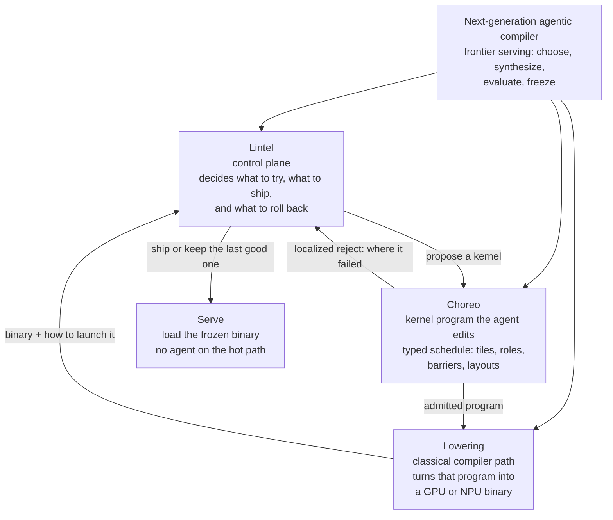

# Architecture (e2e stack + mechanisms)

**Goal:** a next-generation **agentic compiler** for frontier serving and training workloads. It chooses optimization actions, synthesizes implementations, evaluates them under a fixed contract, and can later change its compiler tools or its own decision procedure when those experiments pay for themselves. Serve loads a frozen binary. Lintel is the **control plane** of that compiler.

**Year-1 implementation of that goal:** one hot region, an allowlisted kernel proposal, classical check and lowering, application measurement, freeze, replay. The proposer may be an agent, a learned policy, or conventional search; the demo uses an agent. Scope and the three evolution loops: [SURVEY_MATCH.md](SURVEY_MATCH.md) (survey of 23 September 2026).

Cake, DeepSeek Harness, and GEAK are **mechanisms**. Why the control IR exists and how Acme walks hit today’s stack: [WHY.md](WHY.md). Kernel face: [DATA_PLANE.md](DATA_PLANE.md), [CHOREO.md](CHOREO.md). LLM role: [LLM_IR.md](LLM_IR.md). Independent IR survey: [LLM_ORIENTED_IR.md](LLM_ORIENTED_IR.md).

## Goal (the picture)

Three pieces **are** the compiler. Serve is the *outcome*, not a fourth compiler box. Goal arrows into Lintel / Choreo / Lowering mean composition, not three independent jobs.



```text
  next-generation agentic compiler     ← the goal

  searcher
     │
     ▼
  Lintel          walk a specialize job
     │               propose a kernel
     ▼
  Choreo          the program  +  checks before codegen
     │               pass → lower     fail → try the next kernel
     ▼
  Lowering        GPU cubin  or  NPU binary
     │
     ▼
  Lintel          measure on the real serving path
                  keep it, or revert
     │
     ▼
  Serve           frozen binary only. no model in the loop.
```

| Piece | Role |
|---|---|
| **Goal** | Agentic compiler for frontier serving: choose, synthesize, evaluate, freeze. Year-1 picture below. |
| **Lintel** | Orchestrates search, admit, freeze, rollback. This repo. |
| **Choreo** | The typed kernel the agent is allowed to edit. Sibling repo. |
| **Lowering** | Deterministic codegen (sink). Not an LLM. Not this repo. |
| **Serve** | `lookup(%k)`. Not part of search. |

**What the picture claims.** The year-1 application loop. Localized `{where}` is a **CFG edge** back to Lintel. Lowering returns a binary **and** launch metadata; Lintel still owns land vs last_good. Lintel appears twice in the ASCII walk because it is the same controller: propose, then admit on application measurement.

**What this picture leaves out.** It is one of three loops. The compiler loop and the controller loop are below. It also leaves out joint search over graph, communication, and placement. Those open when a profile says the kernel row is not the limit ([SURVEY_MATCH.md](SURVEY_MATCH.md)). This plan repo does not emit cubins. A printer that comments `Pipeline.depth` is not Lowering. Mid-walk `check.py` rewrite stays forbidden.

Maps onto Cake’s three jobs: (1) Choreo face, (2) Lowering/sink, (3) Lintel’s outer application loop plus, separately, compiler PRs. Year-1 searches the **kernel schedule** only. Serving measurement is the oracle.

## E2E software stack

Two paths. Same cache key. The specialize path may use an LLM. The serve path must not.

```text
 MODEL / FRAMEWORK          torch.compile · exported graph
        │
        │  regions · fingerprints · Amdahl rank
        ▼
 fitness F = serving tokens/s (or TTFT) · quality parity · $/compile
        │
 ┌──────┴───────────────────────────────────────────────────────────┐
 │  LINTEL CONTROL PLANE                                            │
 │                                                                  │
 │   Lintel IR (CFG · cost · cache_key · land|revert|reject)       │
 │      %k = cache_key(graph, hw, compiler, adapter, policy)        │
 │                                                                  │
 │   session log = interpretation trace     (DSH pattern)           │
 │   seams: llm · tools · sandbox · adapter · oracle · serving      │
 └──────┬───────────────────────────────┬───────────────────────────┘
        │ SPECIALIZE (CI / overnight)   │ SERVE (production)
        │ compile → ADG; walk ADG      │ lookup %k
        │ LLM fills enum slots only     │
        ▼                               ▼
 admit record (lowering)          hit: artifact.digest
 land under %k                    miss / replay-fail:
        │                           last_good | classical
        ▼                               │
 adapter IR  Choreo Kernel AST (yr1) │  NO LLM
   GPU sink (must consume schedule)  │
   later: @tirx.v0 / @tilelang.ascend│
        │                               │
        ▼                               ▼
 classical lowering / vendor libs ──► SGLang xor vLLM ──► GPU
```

**Invariant.** If the controller, the LLM, or a plugin dies, `lookup(%k)` still serves the last freeze (or classical). That is the commercial sentence.

**Year-1 width.** One GPU family, one adapter, one serving engine. Default: NVIDIA + **Choreo** face + one GPU **sink** that consumes the schedule (Triton/TIRx/CUTLASS — a stencil that comments `Pipeline.depth` is not it) + (SGLang xor vLLM). Home fleet is a kickoff **sink swap**, not a second live face. Ascend is a later second sink.

## Lintel IR and today’s stack

L1–L7 below are **our names for the stack a partner already runs**. The survey’s [§5.1.2](https://github.com/zackc6/ai-compiler-survey/blob/main/docs/SURVEY.md) (23 September 2026) is a checklist of decision areas, not a required layer count, and it does not define an “L8.” Lintel IR is the control plane that talks to those areas. One analytical cost model across the whole stack stays a non-goal. Which area year-1 searches, and when another area opens: [SURVEY_MATCH.md](SURVEY_MATCH.md).

```text
  L1  Framework graph     torch.compile / exported module
  L2  Portable graph IR   graph_hash in %k (StableHLO-class when present)
  L3  Mid-IR / dialects   Inductor / MLIR / HLO — classical, not proposed in PoC
  L4  Kernel DSL          adapter: Choreo Kernel AST (yr1) · GPU sink · Tile / HIP / `@tirx.v0` / `@tilelang.ascend` / Cake (later wraps)
  L5  Backend / ISA       PTX / SASS — classical lowering of L4
  L6  Runtime / serving   SGLang xor vLLM · CUDA Graphs · lookup(%k)
  L7* Fleet / cluster     out of PoC; later placement plugin, not a FleetIR SKU
  L0* CPU / LLVM          job (b) — out
        │
        │  control plane talks *to* bands through seams
        ▼
  Lintel IR  triage / propose / gate / cost / land   ← this product
  ADG walk   (specialize)          lookup(%k) (serve)
```

Worked example: [examples/poc/acme_attn_prefill.poc.lintel](../examples/poc/acme_attn_prefill.poc.lintel). Same `%k`. Each op touches one band (or none — control only). Step-by-step walks (land / revert / cost skip / cold / replay): [WHY.md](WHY.md).

| PoC op | Band | What happens | What Lintel IR does **not** do |
|---|---|---|---|
| `region` + `graph = sha256:bbcd57…` | **L1→L2** | Fingerprint of the captured attn-prefill subgraph | Rewrite the torch graph; invent a portable IR |
| `triage` · `cond %r.hot` | **L1** (cut) + Amdahl | Skip cold regions (`^cold` → `revert`) | Fuse ops at L3; change the export boundary |
| `pins.compiler` / `adapter = @choreo.v0` | **L3/L4 pin** | Which classical stack must replay (`choreoir` + sink) | Run InstCombine / Inductor passes |
| `%p0 = propose … kernel choreo.attn.d3.w4` | **L4** | Fill an allowlisted Choreo Kernel AST | Emit CUDA, free Triton source, or Cake IR |
| `gate adapter` `{where: L}` | **L4 pre-codegen** | `choreoir.check` localized Finding | A new checker IR inside Lintel |
| `gate golden` / `gate numerical` | **L4 after L5 lower** | Oracle on the cubin the adapter produced | Legalize PTX; allocate registers |
| `cost … budget.usd = 50` | **control** (survey: economics are not a band) | Skip L6 A/B if it cannot pay back | A universal L1–L7 analytical model |
| `gate serving_ab` · `fitness F = tokens/s × parity` | **L6** | Warm-server A/B + output parity | Own CUDA Graphs / KV cache / the engine |
| `land %p0 under %k` | **L6 freeze** | `store[%k] = digest`; serve is `lookup(%k)` | Re-run Lintel IR on the hot path |
| *(not in PoC)* `place` | **L7** | Later plugin ([LATER.md](LATER.md) coverage) | Ship FleetIR |

**C4** (Triton vs Tile vs Cake IR) is an **L4 sink** fight. Year 1 picks one L4 **face** (Choreo) and one printer. A second DSL is a new `adapter_id` or printer (new `%k`), not a new Lintel IR.

A recurring kernel fail becomes a **PR on `choreoir`**. After merge, `check` is still an ordinary function, `compiler_ver` bumps, and the next application job has a new `%k`. A tighter allowlist is a new `policy_id`, not that PR. An L5 `where` (`ptx.barrier`) may later grow as an **oracle plugin** here. It does not grow an ISA dialect in this company. Spec: [CHOREO.md](CHOREO.md) Undergo.

**L0 / job (b)** (Magellan / MLGO) never appears in Lintel IR.

### Three loops

Judgment against the 23 September 2026 survey: [SURVEY_MATCH.md](SURVEY_MATCH.md).

```text
  APPLICATION (year-1 PoC)          COMPILER (across jobs)         CONTROLLER (gated, not year-1)
  pinned policy_id                  recurring {where}              offline procedure delta
  pinned compiler_ver               → choreo PR → human merge      compiler pin fixed, model pin fixed
  propose allowlisted Kernel        → new compiler_ver             dev jobs → freeze → holdout
  check → measure → land|revert     → new %k                       promote policy_id | reject
  serve = lookup(%k)                check stays a pure function    does not store a cubin
                                                                   serve never runs this module
```

Inside one application walk the procedure and the compiler are pinned. Fail `{where: L}` takes the CFG edge to the next kernel. Across jobs, `compiler_ver` and `policy_id` are different fields of `%k`. A session log is memory (`memory_id`, outside `%k`). Rewriting `check.py` or the running ADG mid-walk stays forbidden ([RISKS.md](RISKS.md)). The controller module is [examples/later/controller-dev.sketch.lintel](../examples/later/controller-dev.sketch.lintel). It is not a year-1 milestone.

Worked walks: [WHY.md](WHY.md). Source: [examples/poc/acme_attn_prefill.poc.lintel](../examples/poc/acme_attn_prefill.poc.lintel). Same `graph_hash` `sha256:bbcd57f9…`.

| Walk | Band(s) | What the controller does | What it does **not** reshape |
|---|---|---|---|
| **D cold** `cond %r.hot` → `^cold` revert | **L1** cut | Skip L4–L6 spend (Amdahl / P23) | No torch rewrite, no new L2 IR |
| **F `{where: L}`** Copy Q\[128,64\]→SmQ\[64,64\] | **L4** pre-codegen | CFG **edge** `^try0`→`^try1`; Finding names `c0` | No L1 graph edit; no PTX |
| **A land** adapter+golden+numerical+`serving_ab` +8.1% | **L4→L5→L6** | Only \(F\) admits; then `land` under `%k` | No InstCombine; no CUDA Graphs ownership |
| **B revert** +11% bench, parity 3/1000 | **L6** \(F\) | Microbench does not win; last_good still serves | L4 kernel is not “the optimum” |
| **C cost skip** `worth_measure=false` | **control** (not a band) | Skip L6 canary; economics are policy | No PowerIR / CostIR dialect |
| **E replay** model swap, same `%k` | **L6** freeze | Serve `lookup(%k)`; no LLM | L1–L2 unchanged |
| **Compiler, next night** (not in the PoC file) | **kernel compiler** | New `choreoir` pin; same `graph_hash`; new `%k` | The graph is not re-authored; the procedure (`policy_id`) is not what changed |
| **Controller promote** (not in the PoC file) | **control** | New `policy_id` after a held-out comparison; later jobs re-land | Does not run inside `^try0`; does not edit \(F\) |

The graph is **fingerprinted and triaged** in year 1. Mid-IR is pinned. The kernel schedule is the only year-1 search surface; its compiler can change across jobs. Machine code is the sink’s classical lower. Serving measurement is where admit and freeze live. Placement and CPU/LLVM stay out of the PoC. A second decision area opens only under the widen-when rules in [SURVEY_MATCH.md](SURVEY_MATCH.md).

## Mechanisms (what we take, where they sit)

| Mechanism | From | In this stack | We discard |
|---|---|---|---|
| Typed agent contract + **localized reject** | Cake / Choreo | `propose` **Kernel AST** + `gate adapter` `{where, hint}` + `gate` `{where, seam, reason}` | Cake IR as the kernel language; Choreo-the-company |
| Plugin **seams** + append-only session log | DeepSeek Harness | Runtime around Lintel IR; model-visible ⇒ logged | Coding-agent UX as the SKU; free tool-calling on the SLA path |
| Amdahl on a **warm** server + A/B + parity | GEAK v4 | `triage` + `gate serving_ab` + \(F\) | Instinct-only marketing; hero-kernel as “default agent compile” |
| Artifact-in-VCS / control file | CompileIQ-class | `land %p under %k` → customer git | Vendor-only ACF as the ABI |
| **Cache key + replay** | Artifact identity separate from the search trajectory | `%k = cache_key(...)`; same key ⇒ same terminator or hard fail. `memory_id` stays outside `%k` | Silent retune on model swap; treating a log as a new controller |
| Lintel IR | This product | Control-plane IR; JSON record is a **lowering** | Mega-IR; “one agent IR for all vendors” |

Adapters (Choreo face / Triton printer / Tile / HIP / Cake IR) are **data-plane IRs**. They plug into `adapter`. They are not Lintel IR. Year-1 live adapter contract: [ADAPTERS.md](ADAPTERS.md).

## Lintel IR objects (year-1 kernel)

Five things must be boring. Everything else is a plugin.

### 1. Cache key `%k` (address of the specialize job)

Canonical fields — **not** the kernel text, **not** the model id, **not** the enum:

```text
cache_key.v0 = hash( graph_hash, hw_id, compiler_ver, adapter_id, policy_id )
```

| In the key | Out of the key (on purpose) |
|---|---|
| Which region/graph | `model_id` (audit only) |
| Which HW + compiler + adapter | `enum_id` / proposal body (payload at `%k`) |
| Which **procedure** (`policy_id`: gates, \(F\), search rules) | `memory_id` (session log / retrieval store). Same procedure, new memories, same `%k` |
| | Commentary, SSA temps, token spend |

**Replay law.** Re-interpret under the same `%k`. If the terminator (`land`/`revert`/`reject`) or the landed digest changes, **hard fail — do not serve.** A model swap with the same policy is the same `%k`. A compiler bump **or** a procedure bump is a new `%k` and must re-land. A new memory snapshot is not.

Serve is `lookup(%k)`, not “run the agent again.”

### 2. Lintel IR plan (the program)

Linear block is a **degenerate** CFG. Year-1 executable: [POC.md](POC.md). Coverage: [LATER.md](LATER.md).

```text
%k  = cache_key @region, pins
%r  = triage @region
%p  = propose propose_kernel "<slot>"          // Choreo Kernel AST
%s  = gate adapter %p owner @team      // fail → {where: L, hint: c0}
%g  = gate <oracle> %p owner @team     // fail → {where, seam, reason}
%f  = fitness %g vs last_good
land %p, %f under %k or_else last_good
     | revert last_good under %k
     | reject {where, reason}
```

Spec and examples: [LINTEL_IR.md](LINTEL_IR.md). PoC (CFG + cost + ADG): [POC.md](POC.md). Coverage: [LATER.md](LATER.md).

### 3. Admit record (lowering / merge ticket)

Closed module → versioned JSON in customer git. Humans review this, not the chat. [ADMIT_RECORD.md](ADMIT_RECORD.md).

### 4. Seams (DSH pattern, compiler-shaped)

| Seam | Year-1 provider | Later, no rewrite |
|---|---|---|
| `llm` | One frontier + one small specialist | Any OpenAI-class / local |
| `tools` | `propose` / `verify` / `bench` / `profile` | MCP-class |
| `session` | Append-only log (sqlite ok) | Customer object store |
| `sandbox` | Container / Landlock | Air-gap runner |
| `adapter` | Choreo Kernel AST + `{where: W\|L\|S\|V}` | Tile, HIP, Helion, Cake-class wrap; Triton knobs as degenerate |
| `oracle` | Golden + numerical + shape-grid | Alive2, SMT, FlashInfer-Bench `apply()`, GEAK A/B |
| `serving` | SGLang **xor** vLLM | The other engine |

### 5. Localized reject (Cake idea, portable)

A failed `gate` is not a bit. It names **where** and **which seam**. Adapter fails name a **node hint** (`c0`). A recurring *compiler* limitation becomes a **choreo PR** (new `check` rule, or a sink that lowers `Pipeline.depth`). A recurring *search* limitation becomes a human policy edit in year 1, or — only after the gate in [SURVEY_MATCH.md](SURVEY_MATCH.md) — a controller-development run that promotes a new `policy_id`. The searcher does not merge either change, and Choreo does not rewrite itself.

## Two paths in one picture

```text
 SPECIALIZE                          SERVE
 ──────────                          ─────
 Lintel IR                           lookup(%k)
   │                                   │
   ├─ %k = cache_key                   ├─ hit  → artifact.digest
   ├─ cond (hot / ok / worth_measure)  ├─ miss → last_good | classical
   ├─ propose schedule (allowlisted)   └─ replay-fail → do not serve new
   ├─ gate adapter {where}
   ├─ gate* (owned)
   ├─ cost (same F + budget)
   ├─ fitness F
   └─ land | revert | reject
         │
         ▼
   admit record + session trace
   artifact stored at %k
```

FSM (SLA): walk the PoC ADG (`cond` on hot / ok / worth_measure) → `land | revert`. Lab mode may be looser; it cannot `land` without the SLA graph.

## How this survives survey-driven change

| If this settles in 2027–28 | Lintel change |
|---|---|
| **C3-A** free rewrite wins a public suite | Widen enums *behind* gates; keep Lintel IR |
| **C3-B** constrained actions hold | Keep narrow enums; sell that |
| **C4** Tile / Cake IR / Argus fragment | New `adapter` enum; same `%k` schema |
| **C2** someone publishes default-path p50 | Report partner traces in that format |
| **C5** vendors name ACF workflows | Integrate; we stay the admit/freeze layer |
| Component replacement with no fallback and no contract | Keep check, lower, last_good. One component at a time, on a corpus |
| Cake or Argus open-source | Provider, not a rewrite |
| DSH plugin ABI wins | Oracles + ADG interpreter as `dsh-plugin`s; `%w` freeze is [LATER.md](LATER.md) |

Wrong adapter is recoverable. Wrong “we are the compiler” story is not. `%k` + Lintel IR are the Q1 bets.

## Repo layout (product tree they grow)

This plan repo is `docs/` + `schemas/` + `examples/`. The tree below is the product repo they grow.

```text
schemas/                 # lintel-ir, adapter-proposal, admit-record, cache-key, session
examples/lintel-ir/      # degenerate linear modules (opaque enum_id)
examples/poc/            # CFG + cost + ADG + Choreo Kernel AST (year-1 executable)
examples/later/          # coverage after PoC (%w, richer graphs, degenerate Triton knobs)
src/lintel/              # hash %k, replay law, FSM, seams
adapters/                # year-1 triton/   later tile/ hip/ cake_ir/
oracles/ serving/ cli/
docs/                    # WHY, POC, DATA_PLANE, ADAPTERS, …
```

## Kickoff

Week-1 pins (in `%k` or audit): GPU family, serving engine, op family. Changing them later is a new provider or a new `%k`, not a fork.

## Non-goals

- One universal cost model for L1–L7. PoC `cost` is the same pinned \(F\) + a budget ([POC.md](POC.md)).
- One mega-IR / Cake IR as the SKU.
- Always-on frontier model at every customer compile.
- Serving a proposal before \(F\)-admit.
- Putting `model_id` or free text into `%k`.
- Selling “the controller improves itself” as a year-1 feature. The loop is specified in [LATER.md](LATER.md) and stays gated.
- Putting the model on `lookup(%k)`, or dropping check and fallback in order to call the system agentic. Year-1 still checks, lowers, and measures classically.
